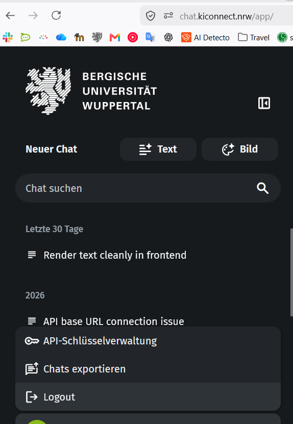

# Learning Adventure
AI-based assistants to generate personalized exercises, provide feedback on solutions, and adapt to individual learning preferences. 

# You have to create an .env file in the backend, look at the src/backend/.env.example
```
You will have to set MODEL, OPENAI_API_KEY, OPENAI_API_BASE in the .env you just created
```
### You can use genAI4BUW model if you are participating in BUW


# Inside backend
```
# Navigate into the frontend directory
cd backend
# Install dependencies and start the api server
uv sync
uv run main.py
```

# Start frontend
```
# Navigate into the frontend directory
cd frontend
# Install dependencies and start the development server
npm install
npm run dev
```

# Visit Frontend using default Address```http://localhost:5173/``` 
```
# The login button is on the bottom left

# The default course profile is created at backend/services/InitServices.py 
    werkstatt = Profile(
        id = "code_bar_programmierwerkstatt",
        user_id= 9999999,
        profile_name = "Code_bar_programmierwerkstatt"
        )
```
## You will need an account with admin rights if you want to create profile/course using the frontend.
## Pleate note that the profile creation using frontend will not allow customized name.
```
    matriculation_number="9999999",
    username="Endministrator",
    password= "Ganyu.01Emilie.02Fehler.03",
    is_admin = True
```
## This account is created in backend/services/InitServices.py 

## You can also visit ```http://0.0.0.0:8000/docs``` if you are in the host machine you can check backend/main.py to know how the port is created
